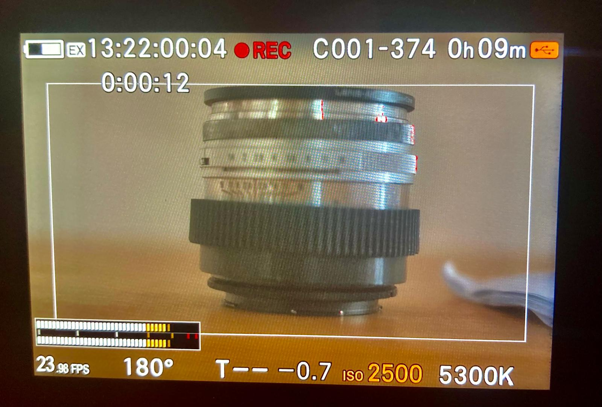

# TCAudio

**TC-IN and audio at the same time on the SIGMA fp.**



Out of the box, the fp cannot record audio and sync to timecode (TC) at the same time. Enabling the timecode input (TC-IN) disables audio recording and the camera writes DNGs with no WAV track. TCAudio is a module for [fpSup](https://github.com/ijigen/fpSup) that gives you both: video with synced TC and a WAV with the incoming sound in the same take. TCAudio can also record external mics and the camera mics at the same time, on separate channels.

*[Versión en español](README.md)*

## What it does

With external timecode (TC-IN) on, the stock **Audio Recording** row is not disabled as it is in the original firmware. It works like this:

| Audio Recording | Result |
|---|---|
| **ON**, TC on the jack | The generator TC is recorded in the video and the WAV. The sound from the other channel (the microphone or connected source) is recorded on both WAV channels, so the LTC noise is gone. |
| **ON**, jack unplugged | Audio from the camera mics is recorded in stereo. The camera keeps counting TC on its own, and the EX indicator blinks red to warn that it is not receiving external TC. |
| **OFF** | Stock TC-IN operation, no audio. |

## The Audio Input and Int+Ext Mics rows

The module adds two rows to the **Audio Recording > On** submenu. Their values survive a restart, and changes apply at once.

- **Audio Input:** Auto or Internal.
- **Int+Ext Mics:** Off or On. It records, without TC, the camera mics on one channel and the jack on the other.

| TC-IN | Audio Input | Int+Ext Mics | On the jack | Recorded |
|---|---|---|---|---|
| On | Auto | Not available | TC + audio | Jack audio on both channels |
| On | Auto | Not available | TC on both channels | Internal mic on both channels |
| On | Internal | Not available | TC + audio, TC on channel 2 (RWP) | Internal mic on both channels |
| On | Internal | Not available | TC on both channels | Internal mic on both channels |
| On | Internal | Not available | TC on channel 1, nothing on the other (Deity L-OUT) | Internal mic on both channels |
| On | Any | Not available | Nothing | Internal mics in stereo |
| Off | Auto | Off | Anything | Whatever enters the jack, as stock |
| Off | Internal | Off | Anything | Internal mics in stereo, as if the jack were not there |
| Off | Auto | On | Mic | Internal mics on channel 1 and the jack on channel 2 |

With TC-IN on, TC always comes from the jack, and Int+Ext Mics stays Off: if you turn it on, it returns by itself. With Int+Ext Mics On, Audio Input only allows Auto. Int+Ext Mics takes the right jack channel: check your mic arrives there, or use a cable with both channels bridged.

## Also

- Finds which channel carries the TC and copies the sound from the other channel over it before writing the WAV, so the file has the same audio on both channels and no LTC is heard.
- Reads TC with that channel's gain very low (tested at -36).
- Shows the audio level on both meters instead of the TC.
- Locks only if the TC runs at the camera's rate, as stock does. It also tells 23.98 from 24 and 29.97 from 30.
- Tightens TC re-jamming while the camera is stopped: it re-jams at 1 frame of error instead of 2. This also applies with Audio Recording OFF.

## Requirements

- SIGMA fp with firmware **Ver.5.02**. It is the only one tested; the module uses fixed addresses for that version. The fp L has not been tested.
- fpSup **Loader v4**, with SupManager.
- A TC generator. If it also sends audio on the other channel, that audio is recorded; if not, the camera mic can be recorded. Tested with the Rode Wireless PRO, the Deity TC-1 and the Zoom M4 MicTrack, which sends LTC only.

## Installation

1. Copy `TCAudio_v1.2.0.BIN` to the `fpSup` folder on the card.
2. Boot the camera and check in SupManager that **TC Audio** is enabled.
3. Enable TC-IN on the Time Code screen and leave **Audio Recording** ON.

To remove it, disable it in SupManager or delete the file. After locking, wait a few seconds before recording.

## Measured results

With a Rode Wireless PRO and a test fp, except where noted:

- A **29 min 39 s** take at 23.98 fps (42,657 frames): no TC jumps, no lost frames, no drift against the generator clock; a constant +2 frames in that take, recorded right after locking.
- Four short takes: roughly between 0 and +1 frame.
- A constant 1 frame between the camera audio and audio recorded on the RWP transmitters.
- Lock verified at 23.98, 25 and 29.97 (drop-frame too), and rejected when rates do not match.
- Deity TC-1 on A-OUT, with TC on channel 1: locks at its rates, including 59.94.

## Known limitations

- **Audio is mono while TC is present.** Recording has two channels and TC takes one.
- **With TC on both channels and Audio Input on Auto,** the internal mic comes in on leaving the menu or pressing REC. Until then the meters may show the TC.
- **The camera does not re-jam TC during a take.** Plugging the jack mid-take changes the audio; TC is corrected on the next take.
- **Plugging or unplugging the jack while recording** causes about a second of transition, and LTC may be heard for an instant when plugging in.
- **The gain knob of the TC channel** can be moved but changes neither sound nor meter. It has not been tested at maximum. The audio channel's knob moves both meters.
- **TC on channel 1 with audio on the other (Deity TC-1 on A-OUT) does not support Internal:** they would mix. For the camera mic use L-OUT; for the Deity mic, A-OUT in Auto.
- **In Auto, with TC on one channel and nothing on the other** (Deity L-OUT), there is no sound to record: use Internal.
- **To change generator,** it is best to turn the camera off and on.
- **Switching Audio Recording from ON to OFF** leaves the meter showing signal until you record or pass through the menu.

## Not tested

- Other generators.
- Drop-frame takes that cross a minute.
- 48 and 50 fps with TC.

## Building

```bash
FPSUP_REPO=/path/to/fpSup python3 -B build_tcaudio.py --out out
FPSUP_REPO=/path/to/fpSup python3 -B -m unittest test_tcaudio
```

Building and testing need firmware 5.02 extracted on your own: the row is composed against the stock menu page, and the tests use fpSup's emulator. Details are in [docs/TECHNICAL.md](docs/TECHNICAL.md).

## License and authorship

GPL-3.0-or-later. Author: Pablo Sánchez. Code written by Claude (Anthropic). See [NOTICE](NOTICE).

This project is not affiliated with SIGMA or fpSup. It modifies the firmware in the camera's RAM: use it at your own risk.
