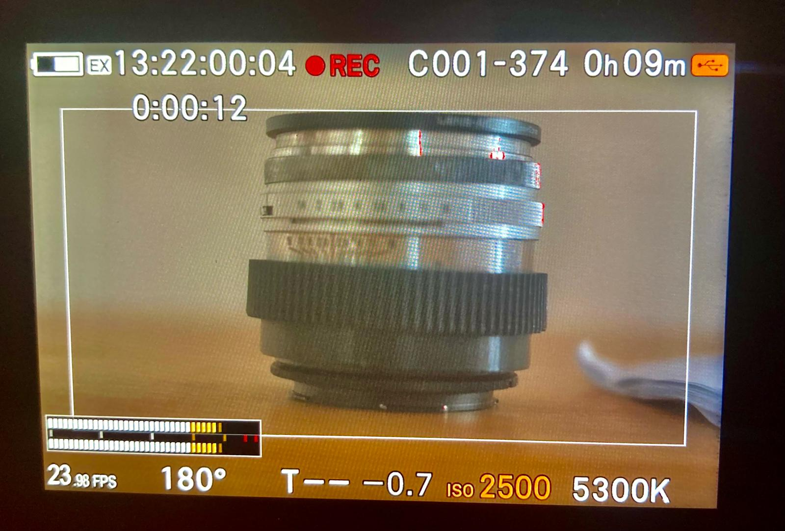

# TCAudio

**TC-IN y audio a la vez en la SIGMA fp.**



De serie la fp no puede grabar audio y sincronizarse por Time Code (TC) al mismo tiempo. Al activar la entrada de código de tiempo (TC-IN) la fp inhabilita la grabación de audio y crea DNGs sin pista WAV. TCAudio es un módulo para [fpSup](https://github.com/ijigen/fpSup) que permite tener las dos cosas: el video con TC sincronizado y un WAV con sonido entrante en la misma toma. TCAudio también permite grabar en canales distintos con micros externos y con los de la cámara simultáneamente.

*[English version](README.en.md)*

## Qué hace

Con el Código de Tiempo externo (TC-IN) activo, la fila de serie **Grabación de audio** no se desactiva como hace el firmware original. Funciona de este modo:

| Grabación de audio | Resultado |
|---|---|
| **ON**, con TC en el jack | El TC del generador se graba en el video y en el WAV. El sonido del otro canal (el micrófono o la fuente conectada) se graba en ambos canales del WAV: desaparece el ruido de LTC. |
| **ON**, jack desconectado | Se graba el audio de los micros de la cámara, en estéreo. La cámara sigue contando el TC por su cuenta, y el indicador EX parpadea en rojo para avisar de que no recibe TC externo. |
| **OFF** | Funcionamiento TC-IN de serie, sin audio. |

## Las filas Audio Input e Int+Ext Mics

El módulo añade dos filas en el submenú de **Grabación de audio > On**. Los valores se conservan al reiniciar, y los cambios se aplican al momento.

- **Audio Input:** Auto o Internal.
- **Int+Ext Mics:** Off u On. Sirve para grabar sin TC los micros de la cámara en un canal y el jack en el otro.

### Con TC-IN activo: qué elegir según el generador

En Auto el módulo distingue el canal del TC del de audio y graba el audio. Si el generador no manda audio (Deity L-OUT, Zoom M4), no hay audio que grabar: usa Internal para tomar el audio de la cámara.

| Generador | Audio Input | Se graba |
|---|---|---|
| TC por un canal y audio por el otro (Rode Wireless PRO, Deity TC-1 en A-OUT) | Auto | El audio del generador, en los dos canales |
| Solo TC (Deity TC-1 en L-OUT, Zoom M4) | Internal | El micro interno, en los dos canales |
| TC por los dos canales (Rode Wireless PRO en modo todo TC) | Auto o Internal | El micro interno, en los dos canales |
| TC y audio, pero quieres el micro de la cámara (Rode Wireless PRO) | Internal | El micro interno, en los dos canales |
| Nada conectado | Cualquiera | Los micros internos, en estéreo |

Con TC-IN activo, Int+Ext Mics se queda en Off: si la activas, vuelve sola.

### Con TC-IN apagado

| Audio Input | Int+Ext Mics | Se graba |
|---|---|---|
| Auto | Off | Lo que entra por el jack, como de serie |
| Internal | Off | Los micros internos en estéreo, como si el jack no estuviera |
| Auto | On | Los micros internos en el canal 1 y el jack en el canal 2 |

Con Int+Ext Mics en On, Audio Input solo admite Auto. Int+Ext Mics toma el canal derecho del jack: comprueba que tu micro llega por ahí, o usa un cable con los dos canales puenteados.

## Además

- Detecta en qué canal llega el TC y copia el sonido del otro canal sobre él antes de grabar el WAV, de modo que el fichero lleva el mismo audio en los dos canales y no se oye el LTC.
- Lee el TC con la ganancia de ese canal muy baja (probado a -36).
- Muestra el nivel del audio en los dos vúmetros, en vez del TC.
- Solo engancha si el TC va a la misma velocidad que la cámara, como de serie. Distingue también 23,98 de 24 y 29,97 de 30.
- Afina el reajuste del TC con la cámara parada: reajusta con 1 fotograma de error en lugar de 2. Esto también se aplica con la grabación de audio en OFF.

## Requisitos

- SIGMA fp con firmware **Ver.5.02**. Es el único probado; el módulo usa direcciones fijas de esa versión. No se ha probado en la fp L.
- **Loader v4** de fpSup, con SupManager.
- Un generador de TC. Probado con el Rode Wireless PRO, el Deity TC-1 y el Zoom M4 MicTrak.

## Instalación

1. Copia `TCAudio_v1.2.1.BIN` en la carpeta `fpSup` de la tarjeta.
2. Arranca la cámara y comprueba en SupManager que **TC Audio** está activo.
3. Activa TC-IN en la pantalla Time Code y deja **Grabación de audio** en ON.

Para quitarlo, desactívalo en SupManager o borra el fichero. Espera unos segundos tras enganchar antes de grabar.

## Resultados medidos

Con un Rode Wireless PRO y una fp de pruebas, salvo donde se indica:

- Toma de **29 min 39 s** a 23,98 fps (42.657 fotogramas): ningún salto de TC, ningún fotograma perdido, sin deriva respecto al reloj del generador; +2 fotogramas constantes en esa toma, grabada justo después de enganchar.
- Cuatro tomas cortas: entre 0 y +1 fotograma aproximadamente.
- 1 fotograma constante entre el audio de la cámara y el grabado en los transmisores del RWP.
- Enganche comprobado a 23,98, 25 y 29,97 (también drop-frame), y rechazo con velocidades que no coinciden.
- Deity TC-1 en A-OUT, con el TC por el canal 1: engancha en sus velocidades, incluida 59,94.
- Rode Wireless PRO en modo todo TC, en Auto: graba el micro interno.
- Zoom M4 y Deity TC-1 en L-OUT, en Internal: graban el micro interno.
- 30 tomas seguidas en una batería de pruebas, con todos los generadores: TC continuo en los DNG, sin huecos.

## Limitaciones conocidas

### De los generadores

- **Zoom M4:** usa Internal. El Zoom lleva la entrada y la salida de TC en el mismo jack (según su manual, la punta es la entrada y el anillo la salida), así que no manda TC por los dos canales: con un cable estéreo, el TC llega al canal derecho y el izquierdo va a la entrada del Zoom. Por esa entrada se cuela un eco del TC (picos en cada flanco) que el módulo no puede leer como TC y trata como audio. En Auto se grabaría ese eco en los dos canales.
- **Deity TC-1 en A-OUT** (TC por el canal 1 y audio por el otro) **no admite Internal:** se mezclarían. Para el micro de la cámara usa L-OUT; para el micro del Deity, A-OUT en Auto.
- **Para cambiar de generador,** apaga la cámara, conecta el nuevo y vuelve a encenderla. Si lo cambias con la cámara encendida en Internal y el TC no engancha, pon Audio Input en Auto un momento y vuelve a Internal.

### Del módulo

- **El audio es mono cuando hay TC.** La grabación tiene dos canales y uno lo ocupa el TC.
- **Con TC por los dos canales, o en Internal,** el micro interno entra al pulsar REC. Hasta entonces los vúmetros pueden mostrar el TC.
- **Al enchufar o quitar el jack grabando** la cámara no se cuelga. Hay cerca de un segundo de transición, y al enchufar se puede oír LTC un instante.
- **La perilla de ganancia del canal del TC** se puede mover, pero no cambia ni el sonido ni el vúmetro. No se ha probado al máximo. La del canal de audio mueve los dos vúmetros.
- **Si cambias Grabación de audio de ON a OFF,** el vúmetro sigue mostrando señal hasta grabar o pasar por el menú.

### De la cámara

- **Drop-frame:** con TC-IN, la fp no deja elegir DF y parece no aceptarlo: cuenta siempre sin drop-frame (NDF). Con un generador a 29,97 DF, el TC de los DNG se adelanta 2 fotogramas en cada cambio de minuto (salvo los múltiplos de 10) dentro de una toma. Pon el generador en NDF.
- **La cámara no reajusta el TC durante una toma.** Si enchufas el jack en plena toma, cambia el audio; el TC se corrige en la toma siguiente.

## Sin probar

- Otros generadores.
- 48 y 50 fps con TC.

## Compilar

```bash
FPSUP_REPO=/ruta/a/fpSup python3 -B build_tcaudio.py --out salida
FPSUP_REPO=/ruta/a/fpSup python3 -B -m unittest test_tcaudio
```

La compilación y las pruebas necesitan el firmware 5.02 extraído por tu cuenta: la fila se compone contra la página de menú original, y las pruebas usan el emulador de fpSup. El detalle está en [docs/TECHNICAL.md](docs/TECHNICAL.md).

## Licencia y autoría

GPL-3.0-or-later. Autor: Pablo Sánchez. Código escrito por Claude (Anthropic). Mira [NOTICE](NOTICE).

Este proyecto no está afiliado a SIGMA ni a fpSup. Modifica el firmware en la RAM de la cámara: úsalo bajo tu responsabilidad.
