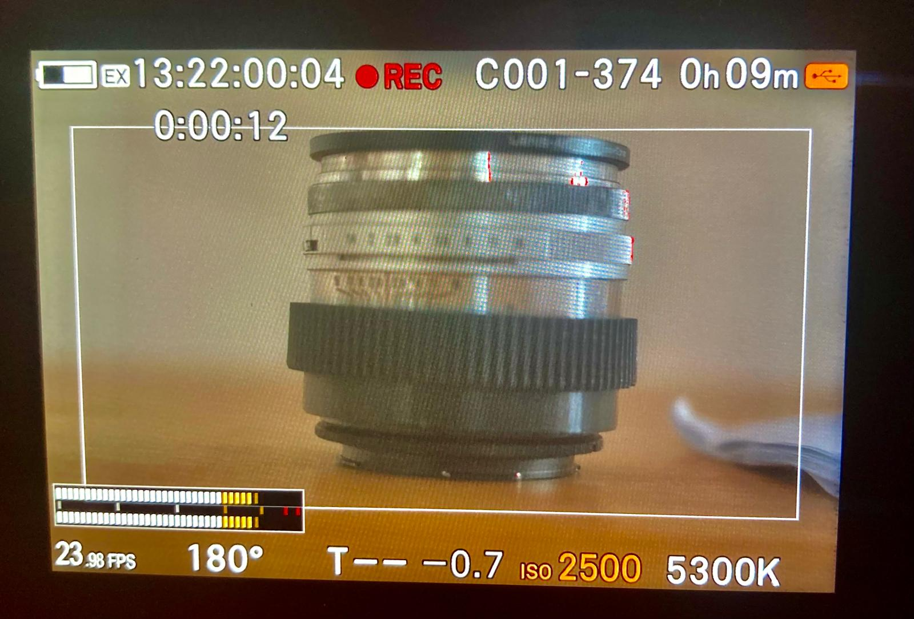

# TCAudio

*[Español más abajo](#español)*

**TC-IN and audio at the same time on the SIGMA fp.**



Out of the box, the fp cannot record audio and sync to timecode (TC) at the same time. Enabling the timecode input (TC-IN) disables audio recording and the camera writes DNGs with no WAV track. TCAudio is a module for [fpSup](https://github.com/ijigen/fpSup) that gives you both: video with synced TC and a WAV with the incoming sound in the same take. TCAudio can also record external mics and the camera mics at the same time, on separate channels.

## What it does

With external timecode (TC-IN) on, the stock **Audio Recording** row is not disabled as it is in the original firmware. It works like this:

| Audio Recording | Result |
|---|---|
| **ON**, TC on the jack | The generator TC is recorded in the video and the WAV. The sound from the other channel (the microphone or connected source) is recorded on both WAV channels, so the LTC noise is gone. |
| **ON**, jack unplugged | Audio from the camera mics is recorded in stereo. The camera keeps counting TC on its own, and the EX indicator blinks red to warn that it is not receiving external TC. |
| **OFF** | Stock TC-IN operation, no audio. |

## The Audio Input and Int+Ext Mics rows

The module adds two rows to the **Audio Recording > On** submenu. Their values survive a restart, and changes apply at once.

- **Audio Input:** Auto or Internal.
- **Int+Ext Mics:** Off or On. It records, without TC, the camera mics on one channel and the jack on the other.

### With TC-IN on: what to choose for your generator

On Auto the module tells the TC channel from the audio channel and records the audio. If the generator sends no audio (Deity L-OUT, Zoom M4), there is no audio to record: use Internal to take the camera's audio.

| Generator | Audio Input | Recorded |
|---|---|---|
| TC on one channel and audio on the other (Rode Wireless PRO, Deity TC-1 on A-OUT) | Auto | The generator audio, on both channels |
| TC only (Deity TC-1 on L-OUT, Zoom M4) | Internal | The internal mic, on both channels |
| TC on both channels (Rode Wireless PRO in all-TC mode) | Auto or Internal | The internal mic, on both channels |
| TC and audio, but you want the camera mic (Rode Wireless PRO) | Internal | The internal mic, on both channels |
| Deity TC-1 on A-OUT, but you want the camera mic | Internal | The internal mic, on both channels; the Deity audio stays out (not confirmed on camera) |
| Nothing connected | Any | The internal mics, in stereo |

With TC-IN on, Int+Ext Mics stays Off: if you turn it on, it returns by itself.

### With TC-IN off

| Audio Input | Int+Ext Mics | Recorded |
|---|---|---|
| Auto | Off | Whatever enters the jack, as stock |
| Internal | Off | The internal mics in stereo, as if the jack were not there |
| Auto | On | The internal mics on channel 1 and the jack on channel 2 |

With Int+Ext Mics On, Audio Input only allows Auto. Int+Ext Mics takes the right jack channel: check your mic arrives there, or use a cable with both channels bridged.

## Also

- Finds which channel carries the TC and copies the sound from the other channel over it before writing the WAV, so the file has the same audio on both channels and no LTC is heard.
- Reads TC with that channel's gain very low (tested at -36).
- Shows the audio level on both meters instead of the TC.
- Locks only if the TC runs at the camera's rate, as stock does. It also tells 23.98 from 24 and 29.97 from 30.
- Tightens TC re-jamming while the camera is stopped: it re-jams at 1 frame of error instead of 2. This also applies with Audio Recording OFF.
- **Mic and remote on the same jack:** with a connection that carries a mic or TC generator and a remote control on the same 3.5 mm TRRS jack, the fp used to record its internal mics. With Audio Input on Auto, as soon as the camera sees the remote on the jack, TCAudio keeps the input on the jack and remote pulses no longer switch it to the camera mics. No menu change is needed. To record the camera mics, choose Internal. If you pull the plug out, the camera goes back to its mics as usual.

## Requirements

- SIGMA fp with firmware **Ver.5.02**. It is the only one tested; the module uses fixed addresses for that version. The fp L has not been tested.
- fpSup **Loader v4**, with SupManager.
- A TC generator. Tested with the Rode Wireless PRO, the Deity TC-1 and the Zoom M4 MicTrak.

## Installation

1. Copy `TCAudio_v1.4.0.BIN` to the `fpSup` folder on the card.
2. Boot the camera and check in SupManager that **TC Audio** is enabled.
3. Enable TC-IN on the Time Code screen and leave **Audio Recording** ON.

To remove it, disable it in SupManager or delete the file. After locking, wait a few seconds before recording.

## Measured results

With a Rode Wireless PRO and a test fp, except where noted:

- A **29 min 39 s** take at 23.98 fps (42,657 frames): no TC jumps, no lost frames, no drift against the generator clock; a constant +2 frames in that take, recorded right after locking.
- Four short takes: roughly between 0 and +1 frame.
- A constant 1 frame between the camera audio and audio recorded on the RWP transmitters.
- Lock verified at 23.98, 25 and 29.97 (drop-frame too), and rejected when rates do not match.
- Deity TC-1 on A-OUT, with TC on channel 1: locks at its rates, including 59.94.
- Rode Wireless PRO in all-TC mode, on Auto: records the internal mic.
- Zoom M4 and Deity TC-1 on L-OUT, on Internal: record the internal mic.
- 30 takes in a row in a test session, across all generators: continuous TC in the DNGs, no gaps.

## Known limitations

### Generators

- **Zoom M4:** use Internal. The Zoom carries TC in and TC out on the same jack (per its manual, tip is the input and ring the output), so it does not send TC on both channels: with a stereo cable, TC reaches the right channel and the left one goes to the Zoom's input. An echo of the TC leaks into that input (spikes at each edge), which the module cannot read as TC and treats as audio. On Auto that echo would be recorded on both channels.
- **Deity TC-1:** to record the TC-1 mic, set it to A-OUT with Audio Input on Auto. To record the camera mic, set it to L-OUT with Audio Input on Internal, or to A-OUT with Internal (not confirmed on camera).
- **To change generator,** turn the camera off, connect the new one and turn it back on. If you swap it with the camera on, you may have reading problems.

### The module

- **Audio is mono while TC is present.** Recording has two channels and TC takes one.
- **With TC on both channels, or on Internal,** the internal mic comes in when you press REC. Until then the meters may show the TC.
- **Plugging or unplugging the jack while recording** does not hang the camera. There is about a second of transition, and LTC may be heard briefly when plugging in.
- **The gain knob of the TC channel** can be moved but changes neither sound nor meter. It has not been tested at maximum. The audio channel's knob moves both meters.
- **Switching Audio Recording from ON to OFF** leaves the meter showing signal until you record or pass through the menu.
- **With a remote-only cable** (no mic or generator) and Audio Input on Auto, the camera takes the jack input and records silence. Choose Internal.
- **With the mic + remote box,** the switch to the external mic comes about 5 s after boot, or up to 1 s after the remote powers up. It never happens while recording.

### The camera

- **Drop-frame:** with TC-IN, the fp does not let you choose DF and seems not to accept it: it always counts non-drop (NDF). With a 29.97 DF generator, the DNG timecode runs 2 frames ahead at each minute change (except multiples of 10) within a take. Set the generator to NDF.
- **The camera does not re-jam TC during a take.** Plugging the jack mid-take changes the audio; TC is corrected on the next take.

## Not tested

- Other generators.
- 48 and 50 fps with TC.
- Mic and remote on the same jack: tested in one take (mic, external TC and Bluetooth remote at once). Long takes and warm boots are still to test.

## Building

```bash
FPSUP_REPO=/path/to/fpSup python3 -B build_tcaudio.py --out out
FPSUP_REPO=/path/to/fpSup python3 -B -m unittest test_tcaudio
```

Building and testing need firmware 5.02 extracted on your own: the row is composed against the stock menu page, and the tests use fpSup's emulator. Details are in [docs/TECHNICAL.md](docs/TECHNICAL.md).

## License and authorship

GPL-3.0-or-later. Author: Pablo Sánchez. Code written by Claude (Anthropic). See [NOTICE](NOTICE).

This project is not affiliated with SIGMA or fpSup. It modifies the firmware in the camera's RAM: use it at your own risk.

---

# Español

**TC-IN y audio a la vez en la SIGMA fp.**

De serie la fp no puede grabar audio y sincronizarse por Time Code (TC) al mismo tiempo. Al activar la entrada de código de tiempo (TC-IN) la fp inhabilita la grabación de audio y crea DNGs sin pista WAV. TCAudio es un módulo para [fpSup](https://github.com/ijigen/fpSup) que permite tener las dos cosas: el video con TC sincronizado y un WAV con sonido entrante en la misma toma. TCAudio también permite grabar en canales distintos con micros externos y con los de la cámara simultáneamente.

## Qué hace

Con el Código de Tiempo externo (TC-IN) activo, la fila de serie **Grabación de audio** no se desactiva como hace el firmware original. Funciona de este modo:

| Grabación de audio | Resultado |
|---|---|
| **ON**, con TC en el jack | El TC del generador se graba en el video y en el WAV. El sonido del otro canal (el micrófono o la fuente conectada) se graba en ambos canales del WAV: desaparece el ruido de LTC. |
| **ON**, jack desconectado | Se graba el audio de los micros de la cámara, en estéreo. La cámara sigue contando el TC por su cuenta, y el indicador EX parpadea en rojo para avisar de que no recibe TC externo. |
| **OFF** | Funcionamiento TC-IN de serie, sin audio. |

## Las filas Audio Input e Int+Ext Mics

El módulo añade dos filas en el submenú de **Grabación de audio > On**. Los valores se conservan al reiniciar, y los cambios se aplican al momento.

- **Audio Input:** Auto o Internal.
- **Int+Ext Mics:** Off u On. Sirve para grabar sin TC los micros de la cámara en un canal y el jack en el otro.

### Con TC-IN activo: qué elegir según el generador

En Auto el módulo distingue el canal del TC del de audio y graba el audio. Si el generador no manda audio (Deity L-OUT, Zoom M4), no hay audio que grabar: usa Internal para tomar el audio de la cámara.

| Generador | Audio Input | Se graba |
|---|---|---|
| TC por un canal y audio por el otro (Rode Wireless PRO, Deity TC-1 en A-OUT) | Auto | El audio del generador, en los dos canales |
| Solo TC (Deity TC-1 en L-OUT, Zoom M4) | Internal | El micro interno, en los dos canales |
| TC por los dos canales (Rode Wireless PRO en modo todo TC) | Auto o Internal | El micro interno, en los dos canales |
| TC y audio, pero quieres el micro de la cámara (Rode Wireless PRO) | Internal | El micro interno, en los dos canales |
| Deity TC-1 en A-OUT, pero quieres el micro de la cámara | Internal | El micro interno, en los dos canales; el audio del Deity no entra (sin confirmar en cámara) |
| Nada conectado | Cualquiera | Los micros internos, en estéreo |

Con TC-IN activo, Int+Ext Mics se queda en Off: si la activas, vuelve sola.

### Con TC-IN apagado

| Audio Input | Int+Ext Mics | Se graba |
|---|---|---|
| Auto | Off | Lo que entra por el jack, como de serie |
| Internal | Off | Los micros internos en estéreo, como si el jack no estuviera |
| Auto | On | Los micros internos en el canal 1 y el jack en el canal 2 |

Con Int+Ext Mics en On, Audio Input solo admite Auto. Int+Ext Mics toma el canal derecho del jack: comprueba que tu micro llega por ahí, o usa un cable con los dos canales puenteados.

## Además

- Detecta en qué canal llega el TC y copia el sonido del otro canal sobre él antes de grabar el WAV, de modo que el fichero lleva el mismo audio en los dos canales y no se oye el LTC.
- Lee el TC con la ganancia de ese canal muy baja (probado a -36).
- Muestra el nivel del audio en los dos vúmetros, en vez del TC.
- Solo engancha si el TC va a la misma velocidad que la cámara, como de serie. Distingue también 23,98 de 24 y 29,97 de 30.
- Afina el reajuste del TC con la cámara parada: reajusta con 1 fotograma de error en lugar de 2. Esto también se aplica con la grabación de audio en OFF.
- **Micro y mando por el mismo jack:** con una conexión que lleva un micro o un generador de TC y un mando remoto por el jack TSSR en el mismo jack de 3,5 mm, la fp grababa sus micros internos. Con Audio Input en Auto, en cuanto la cámara detecta el mando en el jack, TCAudio mantiene la entrada en el jack y los pulsos del mando ya no la pasan a los micros de la cámara. No hay que tocar el menú. Para grabar los micros de la cámara, pon Internal. Si sacas la clavija, la cámara vuelve a sus micros como siempre.

## Requisitos

- SIGMA fp con firmware **Ver.5.02**. Es el único probado; el módulo usa direcciones fijas de esa versión. No se ha probado en la fp L.
- **Loader v4** de fpSup, con SupManager.
- Un generador de TC. Probado con el Rode Wireless PRO, el Deity TC-1 y el Zoom M4 MicTrak.

## Instalación

1. Copia `TCAudio_v1.4.0.BIN` en la carpeta `fpSup` de la tarjeta.
2. Arranca la cámara y comprueba en SupManager que **TC Audio** está activo.
3. Activa TC-IN en la pantalla Time Code y deja **Grabación de audio** en ON.

Para quitarlo, desactívalo en SupManager o borra el fichero. Espera unos segundos tras enganchar antes de grabar.

## Resultados medidos

Con un Rode Wireless PRO y una fp de pruebas, salvo donde se indica:

- Toma de **29 min 39 s** a 23,98 fps (42.657 fotogramas): ningún salto de TC, ningún fotograma perdido, sin deriva respecto al reloj del generador; +2 fotogramas constantes en esa toma, grabada justo después de enganchar.
- Cuatro tomas cortas: entre 0 y +1 fotograma aproximadamente.
- 1 fotograma constante entre el audio de la cámara y el grabado en los transmisores del RWP.
- Enganche comprobado a 23,98, 25 y 29,97 (también drop-frame), y rechazo con velocidades que no coinciden.
- Deity TC-1 en A-OUT, con el TC por el canal 1: engancha en sus velocidades, incluida 59,94.
- Rode Wireless PRO en modo todo TC, en Auto: graba el micro interno.
- Zoom M4 y Deity TC-1 en L-OUT, en Internal: graban el micro interno.
- 30 tomas seguidas en una batería de pruebas, con todos los generadores: TC continuo en los DNG, sin huecos.

## Limitaciones conocidas

### De los generadores

- **Zoom M4:** usa Internal. El Zoom lleva la entrada y la salida de TC en el mismo jack (según su manual, la punta es la entrada y el anillo la salida), así que no manda TC por los dos canales: con un cable estéreo, el TC llega al canal derecho y el izquierdo va a la entrada del Zoom. Por esa entrada se cuela un eco del TC (picos en cada flanco) que el módulo no puede leer como TC y trata como audio. En Auto se grabaría ese eco en los dos canales.
- **Deity TC-1:** para grabar el micro del TC-1, ponlo en A-OUT con Audio Input en Auto. Para grabar el micro de la cámara, ponlo en L-OUT con Audio Input en Internal, o en A-OUT con Internal (sin confirmar en cámara).
- **Para cambiar de generador,** apaga la cámara, conecta el nuevo y vuelve a encenderla. Si lo cambias con la cámara encendida, puedes tener problemas de lectura.

### Del módulo

- **El audio es mono cuando hay TC.** La grabación tiene dos canales y uno lo ocupa el TC.
- **Con TC por los dos canales, o en Internal,** el micro interno entra al pulsar REC. Hasta entonces los vúmetros pueden mostrar el TC.
- **Al enchufar o quitar el jack grabando** la cámara no se cuelga. Hay cerca de un segundo de transición, y al enchufar se puede oír LTC un instante.
- **La perilla de ganancia del canal del TC** se puede mover, pero no cambia ni el sonido ni el vúmetro. No se ha probado al máximo. La del canal de audio mueve los dos vúmetros.
- **Si cambias Grabación de audio de ON a OFF,** el vúmetro sigue mostrando señal hasta grabar o pasar por el menú.
- **Con un cable solo de mando** (sin micro ni generador) y Audio Input en Auto, la cámara toma la entrada del jack y graba silencio. Pon Internal.
- **Con la caja de micro y mando,** el paso al micro externo llega unos 5 s después de arrancar, o hasta 1 s después de encender el mando. No se hace mientras grabas.

### De la cámara

- **Drop-frame:** con TC-IN, la fp no deja elegir DF y parece no aceptarlo: cuenta siempre sin drop-frame (NDF). Con un generador a 29,97 DF, el TC de los DNG se adelanta 2 fotogramas en cada cambio de minuto (salvo los múltiplos de 10) dentro de una toma. Pon el generador en NDF.
- **La cámara no reajusta el TC durante una toma.** Si enchufas el jack en plena toma, cambia el audio; el TC se corrige en la toma siguiente.

## Sin probar

- Otros generadores.
- 48 y 50 fps con TC.
- Micro y mando por el mismo jack: probado en una toma (micro, TC externo y mando Bluetooth a la vez). Faltan tomas largas y arranques en caliente.

## Compilar

```bash
FPSUP_REPO=/ruta/a/fpSup python3 -B build_tcaudio.py --out salida
FPSUP_REPO=/ruta/a/fpSup python3 -B -m unittest test_tcaudio
```

La compilación y las pruebas necesitan el firmware 5.02 extraído por tu cuenta: la fila se compone contra la página de menú original, y las pruebas usan el emulador de fpSup. El detalle está en [docs/TECHNICAL.md](docs/TECHNICAL.md).

## Licencia y autoría

GPL-3.0-or-later. Autor: Pablo Sánchez. Código escrito por Claude (Anthropic). Mira [NOTICE](NOTICE).

Este proyecto no está afiliado a SIGMA ni a fpSup. Modifica el firmware en la RAM de la cámara: úsalo bajo tu responsabilidad.
